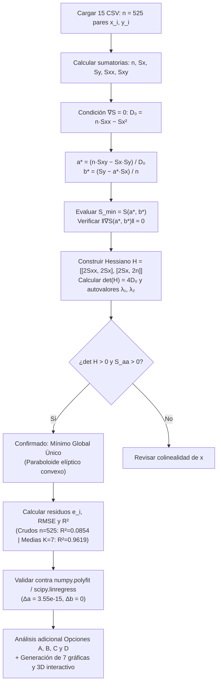

# Pseudocódigo y diagrama de flujo: ajuste por mínimos cuadrados

Cada paso del código (`codigo/ajuste.py`) corresponde exactamente a una etapa del desarrollo analítico manual (`requisitos.md`, secciones 7 a 13).

## 1. Tabla de correspondencia Modelo Analítico ↔ Código Python

| Paso | Expresión matemática (Cálculo Multivariable) | Función / Línea en `codigo/ajuste.py` |
|---|---|---|
| **1. Datos** | Pares $(x_i, y_i)_{i=1}^n$, con $x_i \in \{0,30,\dots,180\}^\circ$ y $y_i$ en ms | `load()` → une los 15 CSV ($n = 525$) |
| **2. Sumatorias** | $S_x = \sum x_i,\; S_y = \sum y_i,\; S_{xx} = \sum x_i^2,\; S_{xy} = \sum x_i y_i$ | `fit(x, y)` → acumula sumas sin librerías de regresión |
| **3. Punto crítico** | $\nabla S(a,b) = (0,0) \implies D_0 = nS_{xx} - S_x^2$ | `d = n * sxx - sx**2` |
| **4. Óptimo $(a^*, b^*)$** | $a^* = \frac{nS_{xy} - S_x S_y}{D_0},\quad b^* = \frac{S_y - a^* S_x}{n}$ | `a = (n * sxy - sx * sy) / d`, `b = (sy - a * sx) / n` |
| **5. Error mínimo** | $S(a^*, b^*) = \sum_{i=1}^n (y_i - a^* x_i - b^*)^2$ | `S(a, b, x, y)` y verificación $\|\nabla S(a^*,b^*)\| \approx 0$ (`grad_S`) |
| **6. Matriz Hessiana** | $H = \begin{pmatrix} 2S_{xx} & 2S_x \\ 2S_x & 2n \end{pmatrix},\quad \det(H) = 4D_0$ | `hessian(x)`, `np.linalg.det(H)`, `np.linalg.eigvalsh(H)` |
| **7. Criterio 2ª derivada** | $S_{aa} > 0 \;\wedge\; \det(H) > 0 \;\wedge\; \lambda_1, \lambda_2 > 0 \implies$ Mínimo global | Impresión y validación en `report()` |
| **8. Equivalencia en medias** | $S(a,b) = \text{SS}_{\text{intra}} + m\,S_{\text{medias}}(a,b)$ ($m=75$, $K=7$) | `report(means_df, ...)` → mismo $(a^*, b^*)$ con $R^2_{\text{medias}} = 0.9619$ |
| **9. Calidad y residuos** | $e_i = y_i - \hat{y}_i,\quad \text{RMSE} = \sqrt{S_{\min}/n},\quad R^2 = 1 - \frac{S_{\min}}{\sum (y_i - \bar{y})^2}$ | `metrics(x, y, a, b)` |
| **10. Validación externa** | Comparación contra `numpy.polyfit` y `scipy.stats.linregress` | $\Delta a = 3.55\times 10^{-15},\; \Delta b = 0,\; \Delta S = 0$ |

## 2. Pseudocódigo estructurado

```text
ALGORITMO AjusteMinimosCuadradosMultivariable
ENTRADA: Lista de archivos CSV con pares (x_i = ángulo_grados, y_i = tiempo_ms)
SALIDA:  Parámetros óptimos (a*, b*), S_min, Hessiano H, métricas (RMSE, R²) y 7 gráficas

INICIO
  1. CARGAR todos los archivos CSV de csvs/*.csv -> vectores x[1..n], y[1..n]
  2. CALCULAR sumatorias base:
       n   <- longitud(x)
       Sx  <- SUMA(x_i para i=1..n)
       Sy  <- SUMA(y_i para i=1..n)
       Sxx <- SUMA(x_i^2 para i=1..n)
       Sxy <- SUMA(x_i * y_i para i=1..n)

  3. RESOLVER sistema normal ∇S(a, b) = (0, 0):
       D0 <- n * Sxx - (Sx)^2
       a* <- (n * Sxy - Sx * Sy) / D0
       b* <- (Sy - a* * Sx) / n

  4. EVALUAR función objetivo en el punto crítico:
       S_min <- SUMA((y_i - a* * x_i - b*)^2 para i=1..n)
       grad  <- [-2 * SUMA(x_i * (y_i - a* * x_i - b*)), -2 * SUMA(y_i - a* * x_i - b*)]

  5. CONSTRUIR y ANALIZAR el Hessiano H:
       S_aa <- 2 * Sxx ;  S_ab <- 2 * Sx ;  S_bb <- 2 * n
       H    <- [[S_aa, S_ab], [S_ab, S_bb]]
       detH <- S_aa * S_bb - (S_ab)^2      // Equivalente a 4 * D0
       autovalores <- EIGVALSH(H)

       SI (detH > 0) Y (S_aa > 0) ENTONCES
           estado <- "Mínimo estricto global (H constante y definida positiva)"
       SINO
           estado <- "No es mínimo estricto (datos degenerados)"
       FIN SI

  6. CALCULAR residuos y calidad del ajuste (datos crudos n=525 y medias K=7):
       PARA i = 1 HASTA n HACER
           e_i <- y_i - (a* * x_i + b*)
       FIN PARA
       RMSE <- RAIZ(S_min / n)
       SST  <- SUMA((y_i - PROMEDIO(y))^2 para i=1..n)
       R2   <- 1 - (S_min / SST)

  7. VERIFICAR contra librerías estándar (numpy.polyfit, scipy.stats.linregress):
       delta_a <- |a* - a_lib| ;  delta_b <- |b* - b_lib| ;  delta_S <- |S_min - S_lib|

  8. EJECUTAR análisis adicional (Sección 13):
       - Opción A: Monte Carlo (500 perturbaciones normales de ±25 ms) -> σ_a, σ_b
       - Opción B: Recalcular sin mayor atípico (fila 262) y sin posibles atípicos (>3000 ms)
       - Opción C: Ajustar modelo cuadrático y = c2*x^2 + c1*x + c0 y comparar R² y RMSE
       - Opción D: Evaluar convergencia de a*(N) para N = 1..15 participantes

  9. EXPORTAR figuras 01..07 (.png) y superficie_interactiva.html
FIN
```

## 3. Diagrama de flujo


