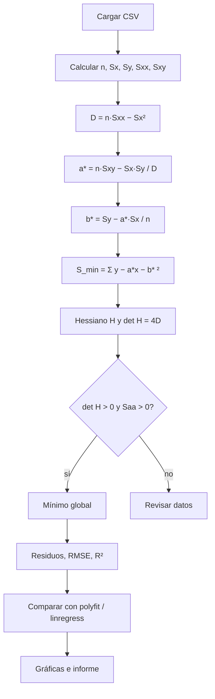

# Pseudocódigo y diagrama de flujo: ajuste por mínimos cuadrados

Cada paso del código (`codigo/ajuste.py`) corresponde a un paso del cálculo a mano.

```
ENTRADA: archivos CSV con (x_i = ángulo, y_i = tiempo)
1. Cargar todos los CSV y unirlos                         -> load()
2. n ← cantidad de datos
3. Sx ← Σ x_i ; Sy ← Σ y_i ; Sxx ← Σ x_i² ; Sxy ← Σ x_i·y_i   (sumatorias, 4.3)
4. D ← n·Sxx − Sx²
5. a* ← (n·Sxy − Sx·Sy) / D                               (pendiente, 4.3)
6. b* ← (Sy − a*·Sx) / n                                  (intercepto, 4.3)
7. S_min ← Σ (y_i − a*·x_i − b*)²                         (error mínimo)
8. H ← [[2·Sxx, 2·Sx], [2·Sx, 2·n]] ; det(H) = 4·D        (Hessiano, 4.4)
9. SI det(H) > 0 Y 2·Sxx > 0 ENTONCES  "mínimo (global)"   (criterio 2ª derivada)
10. e_i ← y_i − (a*·x_i + b*) ; RMSE ← √(S_min / n) ; R² ← 1 − S_min / Σ(y_i − ȳ)²
11. Comparar a*, b*, S_min con numpy.polyfit y scipy linregress
SALIDA: a*, b*, S_min, H, RMSE, R², gráficas
```


