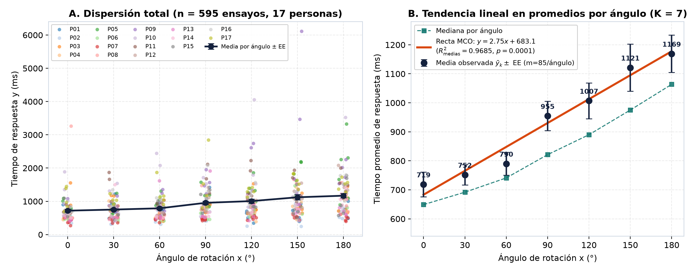
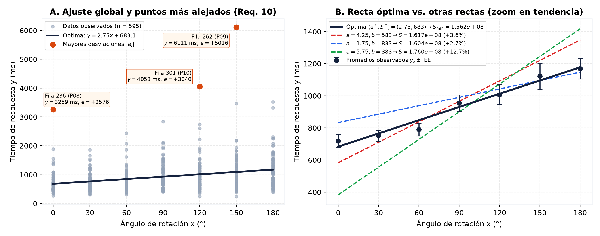
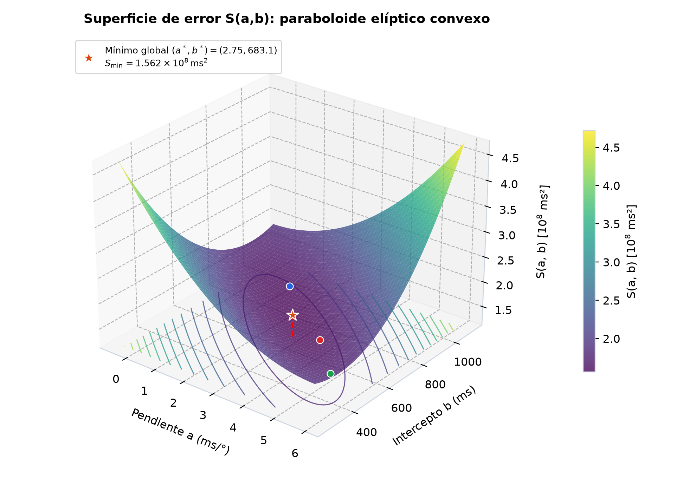
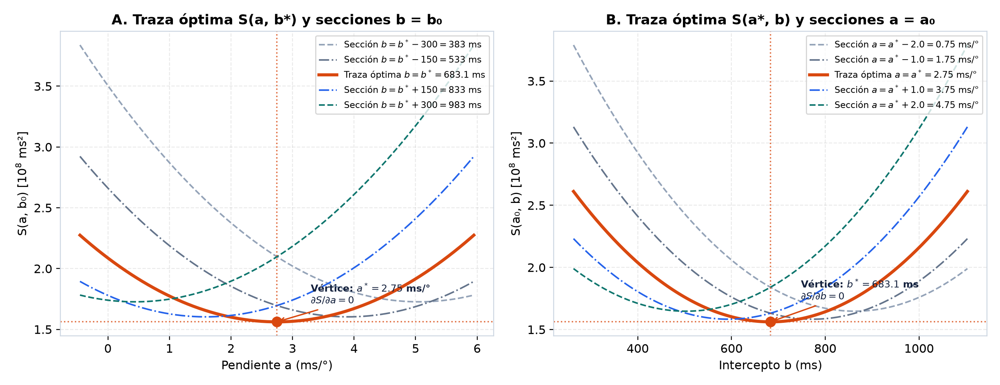
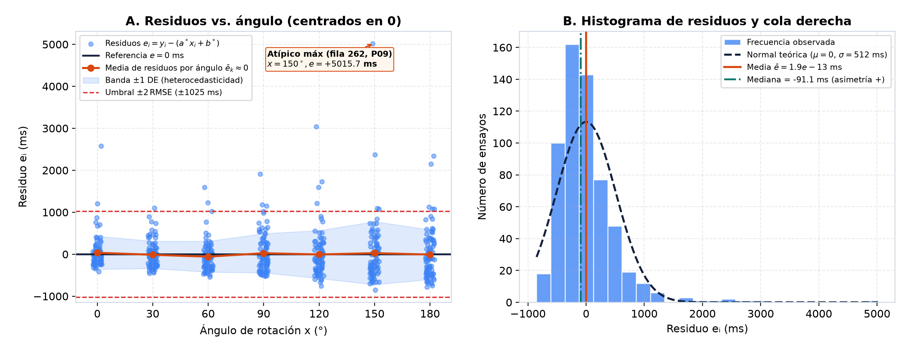

<!-- _class: lead -->
<!-- _paginate: false -->

# NeuroCode: ¿a qué velocidad gira tu cerebro?

¿Cómo usa el Cálculo Multivariable la **mejor recta** del tiempo de rotación mental?

*Proyecto final de Cálculo Multivariable · Universidad Cooperativa de Colombia (Pasto) · 17 de noviembre de 2026*

<!--
Buenas. Medimos cuánto tarda el cerebro en girar una letra R en la mente y buscamos la recta que mejor lo describe. La herramienta es cálculo de varias variables: parciales, gradiente y Hessiano. Todo con datos reales, nada inventado.
-->

---

# Datos reales: ángulo contra tiempo

| Variable | Significado | Unidad |
|---|---|---|
| **x** | ángulo de la letra R | grados |
| **y** | tiempo de respuesta (aciertos) | ms |

n = 595 17 sujetos × 7 ángulos × 5 ensayos
m = 85 / ángulo

Diseño balanceado: cada ángulo pesa igual.

| $\theta$ | $\bar y$ (ms) |
|---|---|
| $0^\circ$ | **718.7** |
| $30^\circ$ | **751.7** |
| $60^\circ$ | **790.0** |
| $90^\circ$ | **954.6** |
| $120^\circ$ | **1006.8** |
| $150^\circ$ | **1121.3** |
| $180^\circ$ | **1169.1** |

Medias por ángulo · m = 85 ensayos c/u

<!--
Cada participante vio una R girada 0, 30, 60, 90, 120, 150 o 180° y respondió si era normal o espejo. Solo aciertos: 5 datos por ángulo, 35 por persona, 595 en total (17 sujetos validados). La tabla muestra medias crecientes con el ángulo, indicio claro de tendencia lineal.
-->

---

# El tiempo sube con el ángulo: la recta sirve

Media **718.7 ms** a $0^\circ$ → **1169.1 ms** a $180^\circ$ · en las medias por ángulo, **$R^2_{\text{medias}}=0.9685$** ⇒ modelo $y=ax+b$ sólido.

<!--
Cada punto es un ensayo. La media sube de 718.7 a 1169.1 ms. Aunque hay dispersión entre personas, en los promedios por ángulo la tendencia lineal explica el 96.85%, así que probamos y = a·x + b.
-->

---

# Medimos qué tan mala es cada recta: S(a, b)

$$S(a,b)=\sum_{i=1}^{595}\big(y_i-\textcolor{#d9480f}{a}\,x_i-\textcolor{#d9480f}{b}\big)^2$$

Al cuadrado: sin cancelaciones, castiga errores grandes y es derivable.

<!--
Cada pareja (a,b) es una recta distinta y S mide su error total. El cuadrado evita cancelaciones, castiga errores grandes y permite derivar. Las rectas punteadas tienen S mayor que la óptima.
-->

---

# En el mínimo, el gradiente es cero

$$\frac{\partial S}{\partial a}=-2\sum x_i\,(y_i-a x_i-b) \qquad \frac{\partial S}{\partial b}=-2\sum (y_i-a x_i-b)$$

$$\nabla S=\mathbf{0}\Rightarrow\begin{cases}\textcolor{#d9480f}{a}\sum x_i^2+\textcolor{#d9480f}{b}\sum x_i=\sum x_i y_i\\\textcolor{#d9480f}{a}\sum x_i+\textcolor{#d9480f}{b}\,n=\sum y_i\end{cases}$$

Plano tangente **horizontal**: no se puede bajar más.

<!--
Derivamos con regla de la cadena tratando la otra variable como constante. Igualar el gradiente a cero da las ecuaciones normales: 2 ecuaciones, 2 incógnitas. Geométricamente, el plano tangente a z=S(a,b) es horizontal.
-->

---

# Resultado: a\* = 2.75 ms/° y b\* = 683.12 ms

n = 595 · Σx = 53 550 · Σy = 553 544.9 · Σx² = 6 961 500 · Σxy = 55 702 551

$$a^*=\frac{n\sum xy-\sum x\sum y}{n\sum x^2-(\sum x)^2}=\frac{3\,500\,688\,450}{1\,274\,490\,000}\approx\textcolor{#d9480f}{2.7467}$$

$$b^*=\frac{\sum y-a^*\sum x}{n}\approx\textcolor{#d9480f}{683.12}\qquad S_{\min}\approx 156\,163\,296$$

<!--
Sumatorias reales verificables con calculadora (y también en 60 segundos con las 7 medias por ángulo). Pendiente 2.7467 ms por grado, intercepto 683.12 ms o tiempo base sin rotación. Error mínimo ≈ 156.16 millones de ms².
-->

---

# El Hessiano confirma: mínimo global

$$\nabla S(a^*,b^*)=[-7.22\times 10^{-9},\,-1.96\times 10^{-10}]\approx\mathbf{0}\qquad H=\begin{pmatrix}13\,923\,000 & 107\,100\\ 107\,100 & 1\,190\end{pmatrix}$$

$$D=\det H=5.098\times 10^9>0 \quad S_{aa}=1.3923\times 10^7>0 \quad \lambda_1=366.13>0,\;\lambda_2=1.3924\times 10^7>0$$

**H constante** ⇒ S es paraboloide convexo: mínimo único y global.

<!--
Verificación numérica del gradiente casi cero. D>0 y S_aa>0 más ambos valores propios positivos confirman mínimo. Como H no depende de a ni b, es global: imposible máximo o silla.
-->

---

# S es un valle con un solo fondo

Elipses **inclinadas** ($S_{ab}=2\Sigma x=107\,100>0$) y **alargadas** ($\lambda_2/\lambda_1\approx 38\,029$); $-\nabla S$ apunta al mínimo.

<!--
Izquierda: superficie z=S(a,b) con mínimo marcado. Derecha: curvas de nivel elípticas centradas en (a*,b*) con campo −gradiente apuntando al centro. Se inclinan por el término cruzado positivo y se alargan porque la superficie es ~38 mil veces más empinada en a que en b.
-->

---

# Cada corte por el óptimo es una parábola

**Trazas óptimas** $S(a,b^*)$, $S(a^*,b)$ con vértice en el óptimo · **Secciones** $S(a,b_0)$, $S(a_0,b)$ paralelas desplazadas hacia arriba.

<!--
Fijar b en b* y mover a da parábola con vértice en a*, igual para a*. Las secciones con b0 o a0 fijos son parábolas paralelas más altas. Visualmente prueba que el fondo es único.
-->

---

# El código replica el cálculo a mano

Cargar CSV
→

n, Σx, Σy, Σx², Σxy
→

a*, b*
→

Smín
→

H, det H
→

¿det H > 0 y Saa > 0?
→

Residuos, RMSE, R²
→

vs. librerías

Algoritmo propio **sin regresión de librería**; `polyfit` / `linregress` solo verifican.

<!--
Diagrama de codigo/ajuste.py: cada caja es un paso del desarrollo manual. Primero sumatorias, luego a* y b*, error mínimo, Hessiano y criterio de segunda derivada, residuos y comparación con numpy y scipy.
-->

---

# Nuestro código y las librerías coinciden

| Parámetro | Manual | Código propio | polyfit / linregress | Δ máx |
|---|---|---|---|---|
| a | 2.7467 | 2.746737 | 2.746737 | 1.29e-14 |
| b | 683.12 | 683.1213 | 683.1213 | 5.68e-13 |
| S mín | 156 163 296 | 156 163 296.22 | 156 163 296.22 | 0.00e+00 |

Tres vías, mismo punto: validación exacta a nivel de redondeo.

<!--
Manual, algoritmo propio y numpy/scipy coinciden hasta 1e-13. La diferencia máxima es ruido de punto flotante: el cálculo analítico queda verificado.
-->

---

# Residuos centrados en 0, más dispersos con el ángulo

Media $\bar e\approx 1.9\times 10^{-13}\approx 0$ · mayor residuo fila 262 ($x=150^\circ$, $e=\mathbf{5015.7}$ ms) · leve abanico: heterocedasticidad.

<!--
Residuos centrados en cero, mayoría entre −1000 y 1000 ms con cola alta. La dispersión crece con el ángulo y el extremo es la fila 262. No hay patrón curvo sistemático: el lineal es aceptable.
-->

---

# Calidad: dos caras de la misma recta

## Ensayos crudos · n = 595

**RMSE = 512.3 ms**
**$R^2 = 0.0938$** ($p=2.2\times 10^{-14}$)

Pendiente altamente significativa; 9.4 % crudo por variación basal entre 17 sujetos.

## Promedios · K = 7 (m = 85)

**Mismos** $a^*=2.7467$, $b^*=683.12$
**RMSE = 29.7 ms · $R^2 = 0.9685$** ($p=0.00006$)

96.85 % de la tendencia media: la recta describe el efecto rotación.

<!--
Misma recta en ambas escalas por diseño balanceado. En ensayos el ruido entre personas baja R² aunque p es 2.2e-14; en medias el ruido se promedia y R² llega a 96.85 %. Por eso el efecto es real y la recta es excelente para la tendencia.
-->

---

# Robustez: sensible, estable y lineal basta

**A Sensib.:** ±25 ms ⇒ $\sigma_a=0.017$ (0.60 %).
**B Atípicos:** sin f.262 $a^*=2.61$, RMSE 469; sin >3 s (n=589) $a^*=2.41$, $R^2=0.1103$.
**C Cuadr.:** $y=0.0030x^2+2.20x+696.8$, $R^2=0.0941$ ($\Delta=+0.0003$).
**D N:** $a^*(N)$ converge desde $N\ge 10$ ($n\ge 350$).

<!--
Las cuatro opciones confirman la recta: A muestra bajísima sensibilidad (0.6%), B que un atípico mueve poco, C que el cuadrático no aporta (+0.0003) y D que desde 10 participantes el ajuste se estabiliza.
-->

---

# Cerebro: paso a paso · Computador: de golpe

## Cerebro

$$t=\textcolor{#d9480f}{683.12}+\textcolor{#d9480f}{2.75}\,\theta$$

≈ **364 °/s**: gira la imagen mental por etapas (Shepard–Metzler).

## Computador

$$R(\theta)=\begin{pmatrix}\cos\theta&-\sin\theta\\\sin\theta&\cos\theta\end{pmatrix}$$

Tiempo **constante**: multiplica la matriz, sin costo por ángulo.

<!--
El cerebro tarda 2.75 ms más por grado, unos 364 °/s: rota paso a paso. Un computador aplica la matriz y tarda lo mismo siempre. Mismo problema, dos estrategias.
-->

---

# Limitaciones: variación entre personas y atípicos

- **17** participantes validados ($n=595$): muestra universitaria acotada.
- Pendiente por persona de **−0.08** (P01, sin efecto) a **8.95 ms/°** (P09).
- Atípicos por distracción (fila 262: +5015.7 ms).
- $R^2_{\text{raw}}=0.0938$ vs. $R^2_{\text{medias}}=0.9685$: falta intercepto aleatorio por sujeto.

<!--
Con 17 personas y pendientes dispares el modelo global mide la tendencia media. Los atípicos y la diferencia de velocidad basal motivan un modelo multinivel por sujeto en trabajo futuro.
-->

---

<!-- _class: demo -->

# Demo en vivo: Laboratorio de Cálculo Multivariable

Abre el simulador 3D con descenso por gradiente en vivo: [`figuras/superficie_interactiva.html`](../figuras/superficie_interactiva.html)

O prueba la app de captura: [`app/index.html`](../app/index.html)

<!--
Abrimos el simulador interactivo: movemos los sliders de (a,b) y pulsamos Animar Descenso (−∇S) para ver en vivo cómo la bola baja por el paraboloide hasta (a*, b*).
-->

---

<!-- _class: lead -->

# Gracias: ¿preguntas?

Integrantes: **[nombre 1] · [nombre 2] · [nombre 3] · [nombre 4]**

<!--
Agradecemos al profesor. Cada integrante puede derivar las parciales y el Hessiano en el tablero. Quedamos atentos a preguntas.
-->
