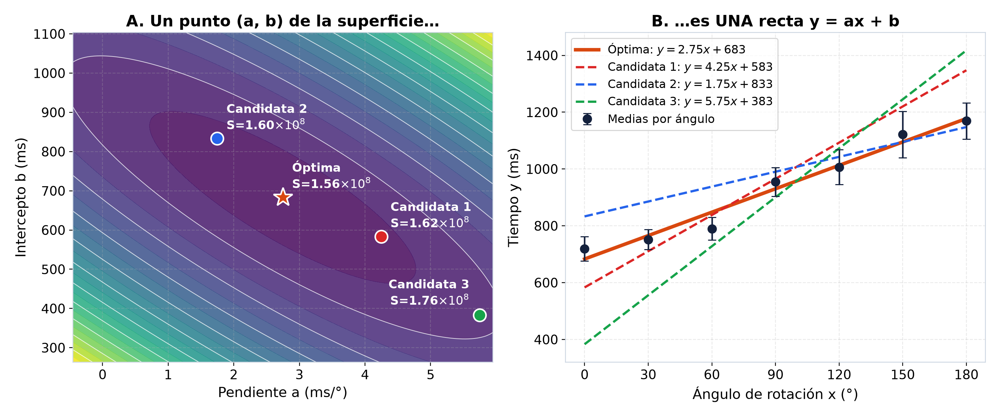
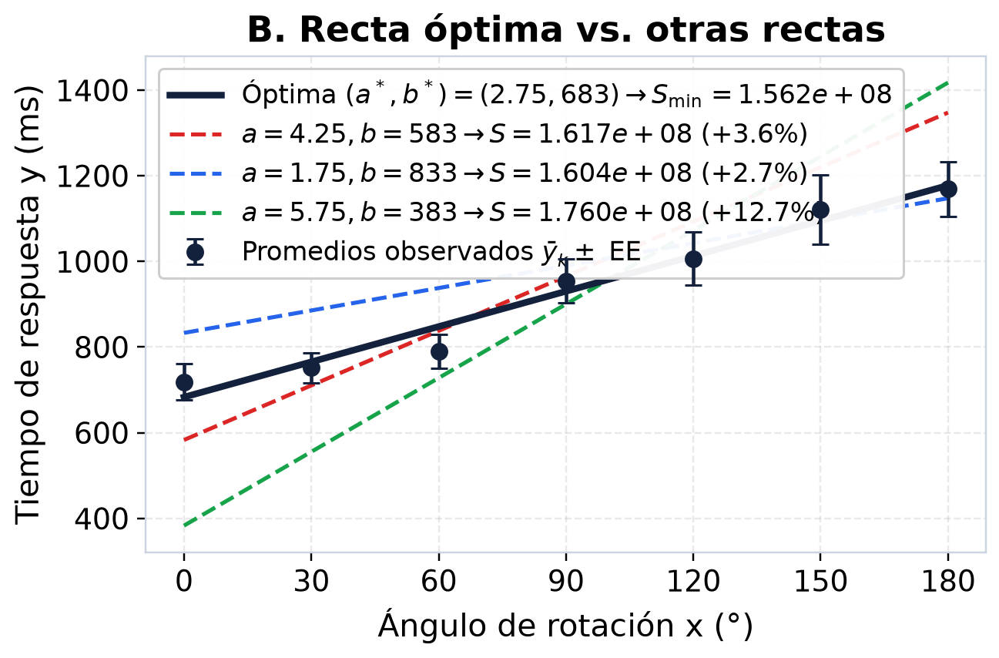
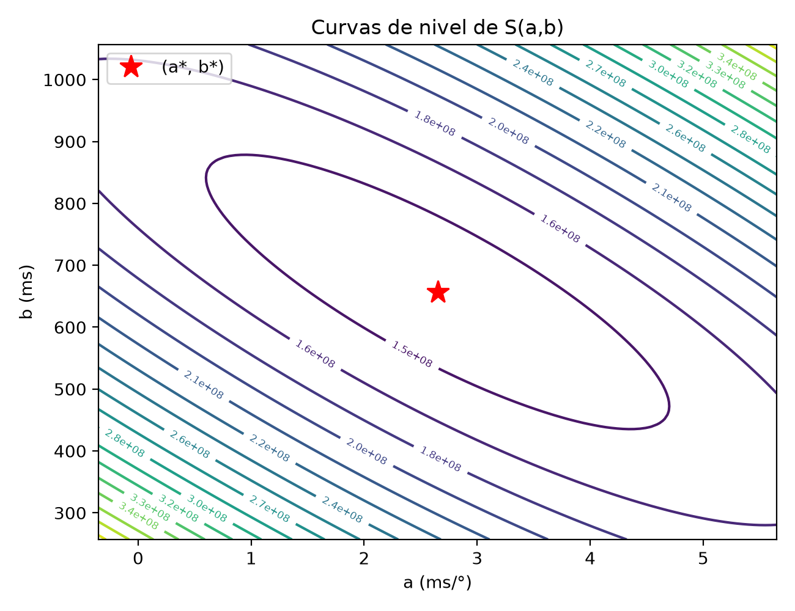
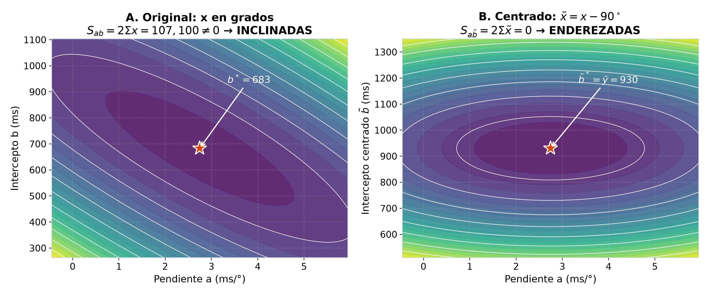
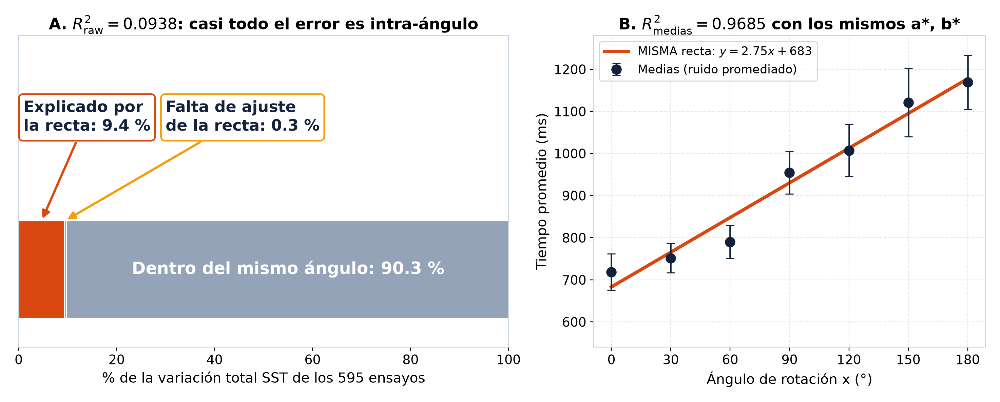
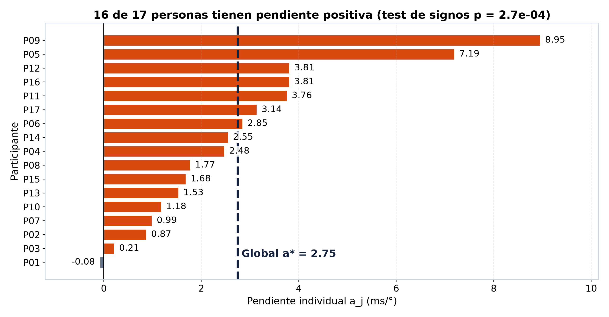
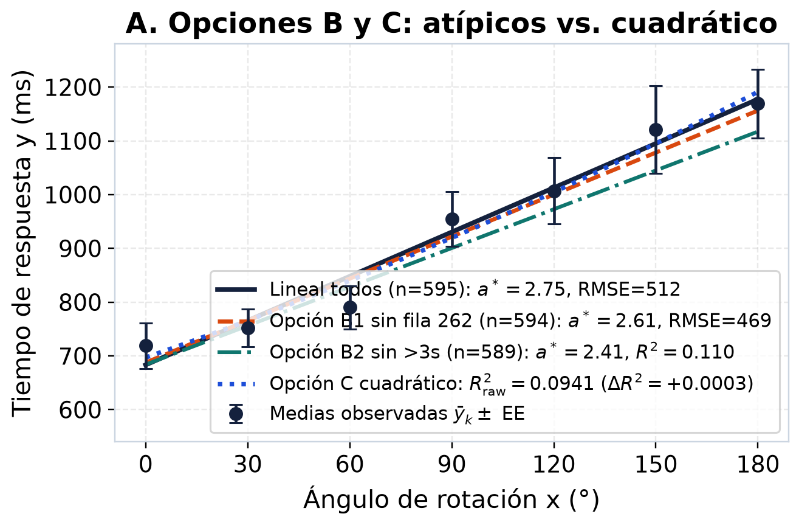
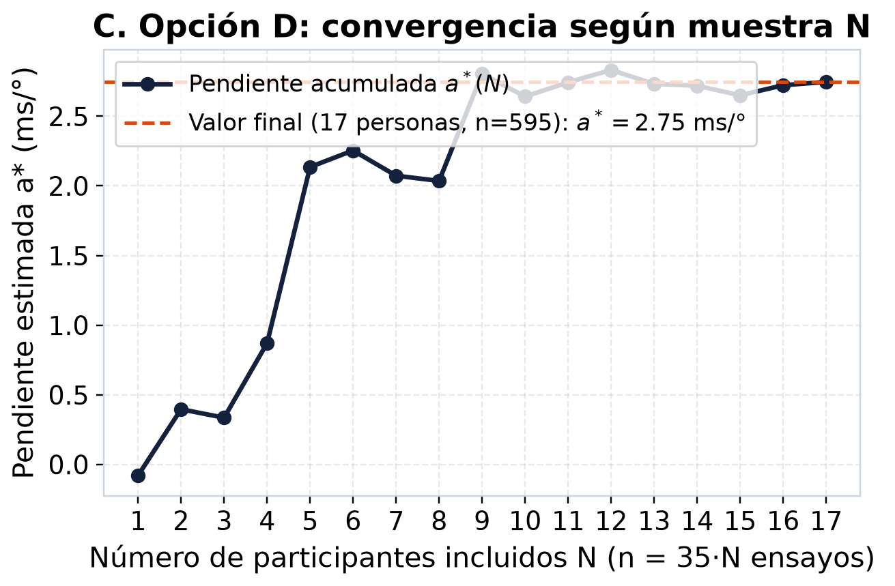
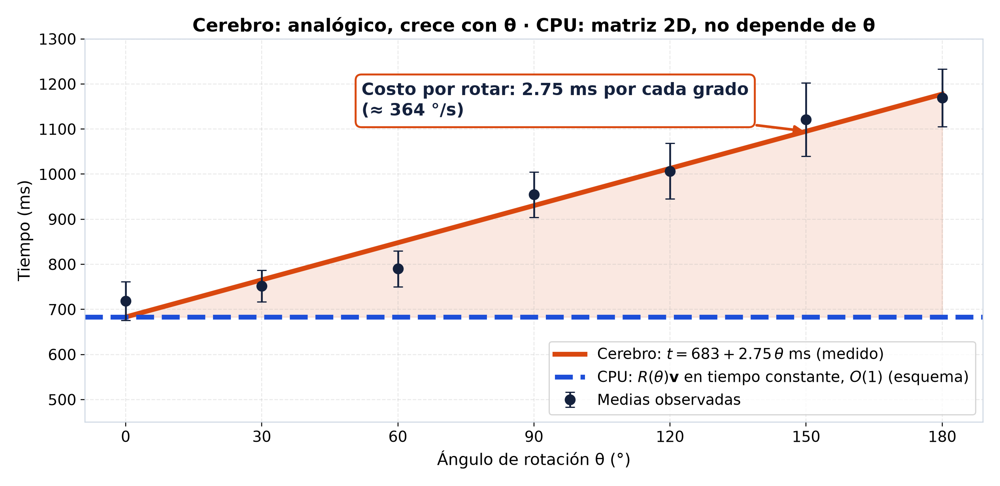

<!-- _class: lead -->
<!-- _paginate: false -->

# NeuroCode: ¿a qué velocidad gira tu cerebro?

Mejor recta del tiempo de **rotación mental** con **Cálculo Multivariable**

*Cálculo Multivariable · Ingeniería de Software · U. Cooperativa de Colombia (Pasto) · M.Sc. Alejandro Molina · 17 de noviembre de 2026*

<!--
Medimos cuánto tarda el cerebro en girar una letra R en la mente y buscamos la recta que mejor lo describe. La herramienta es cálculo de varias variables: parciales, gradiente y Hessiano. Todo con datos reales, inspirado en Shepard y Metzler, 1971.
-->

---

# Un experimento real, tres números

17participantes con sesión completa

7ángulos: 0°, 30° … 180°

595ensayos usados en el modelo (5 aciertos × 7 × 17)

<h2>x = ángulo de la R</h2>en grados

<h2>y = tiempo de respuesta</h2>en milisegundos (solo aciertos)

<!--
Cada participante vio una R girada 0, 30, 60, 90, 120, 150 o 180 grados y respondió si era normal o espejo. Solo aciertos: 5 por ángulo, 35 por persona, 17 personas, 595 ensayos. Diseño balanceado: 85 ensayos por ángulo.
-->

---

# El tiempo sube con el ángulo

Media: <strong>718.7 ms</strong> a 0° → <strong>1169.1 ms</strong> a 180°. ¿Cuál es la mejor recta?

<!--
Izquierda: los 595 ensayos, con mucha dispersión entre personas. Derecha: las siete medias por ángulo, que sí siguen una recta casi perfecta. La pregunta es qué recta y = ax + b es la mejor.
-->

---

# Puente: un punto (a, b) = una recta

Cada punto del mapa es <strong>una recta</strong>; el valle de S marca la <strong>mejor</strong>.

<!--
Esta es la idea central. A la izquierda el plano de parámetros: cada punto (a,b) es un candidato. A la derecha, ese mismo punto dibujado como recta sobre los datos. Los puntos cercanos al fondo del valle dan rectas que se pegan a las medias; los lejanos se despegan. La altura de S es el error de esa recta.
-->

---

# Medimos el error: S(a, b)

$$S(a,b)=\sum_{i=1}^{595}\big(y_i-\textcolor{#d9480f}{a}\,x_i-\textcolor{#d9480f}{b}\big)^2$$

Al cuadrado: sin cancelaciones, castiga lo grande y se puede derivar.

<!--
Cada recta tiene un error total S. El cuadrado evita que errores positivos y negativos se cancelen, castiga los errores grandes y permite derivar. Las rectas punteadas tienen S mayor que la óptima, con el porcentaje en la leyenda.
-->

---

# Mínimo ⇒ gradiente cero

$$\frac{\partial S}{\partial a}=-2\sum x_i\,(y_i-a x_i-b)\qquad \frac{\partial S}{\partial b}=-2\sum (y_i-a x_i-b)$$

$$\nabla S=\mathbf{0}\;\Rightarrow\;\begin{cases}\textcolor{#d9480f}{a}\sum x_i^2+\textcolor{#d9480f}{b}\sum x_i=\sum x_iy_i\\\textcolor{#d9480f}{a}\sum x_i+\textcolor{#d9480f}{b}\,n=\sum y_i\end{cases}$$

Plano tangente <strong>horizontal</strong>: no se puede bajar más

<!--
Regla de la cadena tratando la otra variable como constante. Igualar el gradiente a cero da el sistema normal, dos ecuaciones y dos incógnitas. Geométricamente, el plano tangente a z = S(a,b) es horizontal.
-->

---

# Resultado: qué significan a* y b*

2.75a* · ms por grado

683b* · ms a 0° (tiempo basal)

364ω = 1000/a* · grados por segundo

$$a^*=\frac{n\sum xy-\sum x\sum y}{n\sum x^2-(\sum x)^2}=\frac{3\,500\,688\,450}{1\,274\,490\,000}\approx 2.746737 \qquad b^*=\frac{\sum y-a^*\sum x}{n}\approx 683.1213$$

n = 595 · Σx = 53 550 · Σy = 553 544.9 · Σx² = 6 961 500 · Σxy = 55 702 551 · Smín = 156 163 296.22 ms²

<!--
a* es el costo de rotar un grado: 2.75 milisegundos. Su inverso es la velocidad angular: unos 364 grados por segundo. b* es el tiempo base sin rotación, 683 milisegundos: percibir, decidir y responder. Las sumatorias se verifican con calculadora o en un minuto con las 7 medias.
-->

---

# El Hessiano confirma: mínimo global

$$H=\begin{pmatrix}2\sum x^2 & 2\sum x\\ 2\sum x & 2n\end{pmatrix}=\begin{pmatrix}13\,923\,000 & 107\,100\\ 107\,100 & 1\,190\end{pmatrix}$$

<h2>det H &gt; 0</h2>5.098 × 10⁹

<h2>Saa &gt; 0</h2>1.3923 × 10⁷

<h2>autovalores &gt; 0</h2>λ₁ = 366.1 · λ₂ = 1.39 × 10⁷

<strong>H es constante</strong> ⇒ S es un paraboloide convexo: un único mínimo, global

<!--
Verificamos el gradiente casi cero, del orden de 1e-9. El determinante y S_aa positivos, y los dos autovalores positivos, confirman mínimo. Como H no depende de a ni de b, el mínimo es global: no puede haber máximo ni silla. La curvatura es muy distinta en cada dirección: cociente 38 mil.
-->

---

# S es un valle con un solo fondo

Derecha: <strong>−∇S</strong> siempre baja al mínimo, perpendicular a las curvas de nivel.

<!--
Izquierda, la superficie con el mínimo marcado. Derecha, las curvas de nivel con el campo menos gradiente. Las flechas se dibujan en la escala de pantalla, por eso se ven perpendiculares a las elipses y apuntan al fondo.
-->

---

# ¿Por qué las elipses están inclinadas?

Término cruzado <strong>Sab = 2Σx = 107 100 ≠ 0</strong> → inclinadas. Con <strong>x̃ = x − 90°</strong>: Σx̃ = 0 → ejes alineados.

<!--
El término cruzado S_ab es 2 por la suma de x, y es positivo, por eso las elipses se inclinan: a y b están correlacionados, subir la pendiente obliga a bajar el intercepto. Si centramos x restando 90, que es el promedio de los ángulos, la suma de x tilde es cero, el término cruzado desaparece y las elipses quedan alineadas con los ejes. El mínimo no cambia: el nuevo intercepto es simplemente la media de y, 930 ms, el tiempo a 90 grados.
-->

---

# Cada corte por el óptimo es una parábola

Fija b y mueve a (o al revés): parábola con vértice en el óptimo.

<!--
Fijar b en b* y mover a da una parábola con vértice en a*; lo mismo con b. Las secciones con otro valor fijo son parábolas paralelas más altas. Visualmente, el fondo es único.
-->

---

# El código replica el cálculo a mano

Cargar 17 CSV
→

n, Σx, Σy, Σx², Σxy
→

a*, b*
→

Smín
→

H, det H
→

¿det H &gt; 0 y Saa &gt; 0?
→

Residuos, RMSE, R²
→

Comparar con NumPy / SciPy

<strong>Algoritmo propio</strong> de mínimos cuadrados, <strong>sin regresión de librería</strong>. NumPy y SciPy solo <em>verifican</em>.

<!--
Diagrama de codigo/ajuste.py: cada caja es un paso del desarrollo manual. Primero las sumatorias, luego a* y b*, el error mínimo, el Hessiano y el criterio de segunda derivada, los residuos y la comparación con numpy y scipy. El pseudocódigo está en codigo/pseudocodigo.md.
-->

---

# Nuestro código y las librerías coinciden

| Parámetro | Manual | Código propio | polyfit / linregress | Δ |
|---|---|---|---|---|
| a | 2.7467 | 2.746737 | 2.746737 | ≈ 1e-14 |
| b | 683.12 | 683.1213 | 683.1213 | ≈ 5e-13 |
| S mín | 156 163 296 | 156 163 296.22 | 156 163 296.22 | 0 |

Tres vías, mismo punto: la diferencia es solo ruido de punto flotante

<!--
Manual, algoritmo propio y numpy/scipy coinciden hasta del orden de 1e-14. Esa diferencia es ruido de redondeo, el valor exacto varía algo según la versión de la librería. El cálculo analítico queda verificado.
-->

---

# Residuos centrados en 0, con un atípico claro

Media ē ≈ 0 · mayor residuo: <strong>fila 262 (P09, 150°): +5015.7 ms</strong> · el abanico crece con el ángulo.

<!--
Residuos centrados en cero, la mayoría entre menos mil y mil milisegundos, con cola derecha. La dispersión crece con el ángulo (heterocedasticidad). El extremo es la fila 262 de P09 a 150 grados, una distracción. No hay patrón curvo: lo lineal es aceptable.
-->

---

# Dos R² con la misma recta

<strong>R²raw = 0.0938</strong> — el 90.3 % del error está <em>dentro</em> de cada ángulo (personas distintas y ensayo a ensayo).

<strong>R²medias = 0.9685</strong> — al promediar se cancela ese ruido y aparece la tendencia.

<!--
Es la misma recta, los mismos a y b, evaluada en dos escalas. El 90.3 por ciento de la variación total ocurre dentro de un mismo ángulo: unas personas son más rápidas, y cada persona varía de un ensayo a otro. Ningún modelo que solo conozca el ángulo puede explicar eso, por eso R² crudo es bajo aunque p es 2e-14. Con las medias el ruido se promedia y la recta explica 96.85 por ciento.
-->

---

# ¿Es un efecto real? 16 de 17 personas

<!--
Cada barra es la pendiente de una persona ajustada por separado. 16 de 17 son positivas; solo P01 no muestra efecto. Prueba de signos p = 2.7e-4. La pendiente global 2.75 queda en el centro. P09 es la más alta, 8.95; si la quitamos, a* baja a 2.36 y la conclusión no cambia.
-->

---

# El error se descompone en dos piezas ortogonales

$$S_{\min}=\underbrace{155\,637\,440}_{\text{dentro de cada ángulo}}\;+\;\underbrace{85\cdot S_{\text{medias}}(a^*,b^*)}_{525\,856\ \text{(ajuste de la recta)}}=156\,163\,296$$

<h2>Ruido irreducible</h2>99.7 % de Smín. Ninguna recta lo puede bajar.

<h2>Lo que sí controla la recta</h2>0.3 % de Smín. Por eso minimizar S ≡ minimizar el error sobre las 7 medias.

Con un tiempo base por persona (18 parámetros, ∇S = 0): misma a* = 2.7467 y R² sube a 0.38.

<!--
Descomposición ortogonal: S mínimo es la variación dentro de cada ángulo más 85 veces el error de la recta sobre las medias. La primera pieza no depende de a ni de b. Por eso la recta de los 595 ensayos es exactamente la recta de las 7 medias. Si además damos a cada persona su propio tiempo base, la pendiente sale idéntica y R cuadrado sube a 0.38.
-->

---

# Análisis adicional: A, B, C y D

<h2>A Sensibilidad</h2>Ruido ±25 ms → σa = 0.017 <strong>solo 0.60 %</strong>

<h2>B Atípicos</h2>Sin fila 262: a* = 2.61 Sin &gt; 3 s: a* = 2.41

<h2>C Cuadrático</h2>R² 0.0938 → 0.0941 <strong>ΔR² = +0.0003</strong>: lineal basta

<h2>D Tamaño N</h2>a*(N) se estabiliza desde N ≥ 10 personas

<!--
A: perturbamos cada tiempo con ruido de 25 ms, 500 veces: la pendiente casi no cambia. B: quitar el mayor atípico baja a* a 2.61; quitar todos los mayores a 3 segundos, 2.41. C: el cuadrático mejora R cuadrado en tres diezmilésimas, no aporta. D: con 10 personas o más la pendiente ya se estabiliza.
-->

---

# Robustez en dos imágenes

Las rectas casi se superponen (izq.) y a* converge al sumar personas (der.).

<!--
Izquierda: lineal con todos los datos, sin el atípico, sin los mayores a 3 segundos, y cuadrático: casi indistinguibles sobre las medias. Derecha: la pendiente acumulada a*(N) oscila con pocos participantes y se estabiliza cerca de 2.7.
-->

---

# Transparencia sobre la muestra

| Conjunto | Ensayos | a* (ms/°) |
|---|---|---|
| Los 15 primeros (protocolo original) | 525 | 2.65 |
| **Modelo oficial: 17 con sesión completa** | **595** | **2.75** |
| Todo lo recolectado, sin copias exactas | 875 | 2.41 |

2 de los 17 se sumaron después de ver su ajuste, por eso <strong>también reportamos con 15</strong>. Los 875 incluyen sesiones repetidas y con distracciones. En los tres casos: <strong>a* &gt; 0</strong>.

<!--
Lo decimos de frente: los 15 primeros se recolectaron con el protocolo. Llegaron más archivos, quitamos copias exactas y sumamos dos personas nuevas. Con 15 personas la pendiente es 2.65, con las 17 es 2.75, y con todo lo recolectado, incluso sesiones repetidas y distraídas, 2.41. La conclusión cualitativa no cambia.
-->

---

# Cerebro vs. computador

<h2>Cerebro</h2>analógico: el costo <strong>crece lineal con θ</strong> (≈ 364 °/s)

<h2>Computador</h2>matriz de rotación R(θ) 2×2: <strong>O(1)</strong>, no depende de θ

<!--
El cerebro tarda 2.75 milisegundos más por cada grado: gira la imagen mental paso a paso, como lo propusieron Shepard y Metzler. Un computador aplica la matriz de rotación y tarda lo mismo para 10 que para 180 grados. La línea azul es un esquema, no una medición. Mismo problema, dos estrategias.
-->

---

# Demo en vivo: el laboratorio 3D

<h2>1 · Arrastra</h2>un punto en el mapa: la <strong>recta</strong> cambia al instante

<h2>2 · Observa −∇S</h2>la flecha amarilla siempre apunta al fondo

<h2>3 · Compara</h2>gradiente puro (zigzag) · escalado (250 pasos) · centrado x̃ (39 pasos)

Abrir <code>figuras/superficie_interactiva.html</code> — funciona sin internet

<!--
Abrimos el simulador. Arrastramos el punto sobre el mapa y vemos cómo cambia la recta y los números: S, el gradiente, la velocidad omega y los dos R cuadrado. Pulsamos animar descenso. Con el gradiente puro casi no avanza, porque el cociente de curvaturas es 38 mil; con el gradiente escalado converge en unos 250 pasos; si marcamos centrar x tilde, las elipses se enderezan y converge en 39.
-->

---

# Conclusiones

<h2>1 · La recta</h2>y = 2.75·x + 683: cada grado cuesta <strong>2.75 ms</strong> (≈ 364 °/s)

<h2>2 · El cálculo</h2>∇S = 0 y H definida positiva ⇒ <strong>mínimo único y global</strong>

<h2>3 · Doble R²</h2><strong>0.0938</strong> en ensayos, <strong>0.9685</strong> en medias: misma recta, ruido intra-ángulo

<h2>4 · Límites</h2>17 personas, 16 con efecto positivo; el modelo mide la <strong>tendencia media</strong>

<!--
Resumen: la recta describe el costo de rotar; el cálculo garantiza el mínimo; el doble R cuadrado no es contradicción sino ruido entre personas; y somos transparentes con los límites: muestra pequeña, dos participantes añadidos, atípicos, heterocedasticidad.
-->

---

<!-- _class: lead -->

# Gracias: ¿preguntas?

Cada integrante puede deducir ∂S/∂a, ∂S/∂b y el Hessiano en el tablero.

Integrantes: [nombre 1] · [nombre 2] · [nombre 3] · [nombre 4]

<!--
Agradecemos al profesor. Cada integrante puede derivar las parciales, el sistema normal y el Hessiano en el tablero y comprobarlo con la tabla de 7 medias. Quedamos atentos a preguntas.
-->
