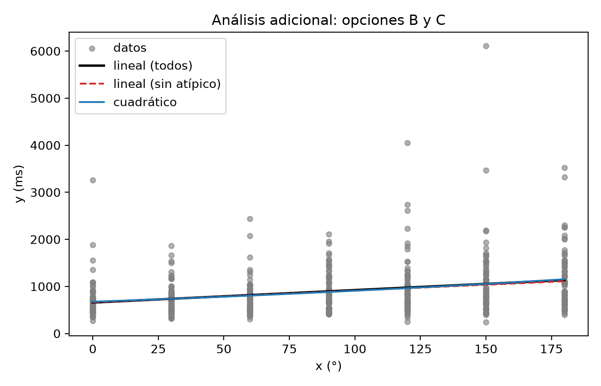

<!-- _class: lead -->
<!-- _paginate: false -->

# NeuroCode: ¿a qué velocidad gira tu cerebro?

¿Cómo usa el Cálculo Multivariable la **mejor recta** del tiempo de rotación mental?

*Proyecto final de Cálculo Multivariable · Universidad Cooperativa de Colombia (Pasto) · 17 de noviembre de 2026*

<!--
Buenas. Medimos cuánto tarda el cerebro en girar una letra en la mente y buscamos la recta que mejor lo describe.
La herramienta es el cálculo de varias variables: derivadas parciales, gradiente y Hessiano.
-->

---

# 525 ensayos, 15 personas: ángulo contra tiempo

| Variable | Significado | Unidad |
|---|---|---|
| **x** | ángulo de la letra R | grados |
| **y** | tiempo de respuesta | ms |

**n = 525** = 15 × 7 ángulos × 5

<!--
Cada participante vio una letra R girada 0, 30, 60, 90, 120, 150 o 180 grados y respondió si era normal o en espejo.
Solo se guardan aciertos: 5 datos por ángulo, 35 por persona, 525 en total. Nada se inventó ni se modificó.
-->

---

# El tiempo sube con el ángulo: la recta sirve

Media: **696.8 ms** a 0° → **1124.2 ms** a 180°

<!--
Cada punto es un ensayo. La media pasa de 696.8 ms sin giro a 1124.2 ms con 180 grados.
Hay mucha dispersión, pero la tendencia creciente es clara, así que probamos y = a·x + b.
-->

---

# Medimos qué tan mala es cada recta: S(a, b)

$$S(a,b)=\sum_{i=1}^{n}\big(y_i-\textcolor{#d9480f}{a}\,x_i-\textcolor{#d9480f}{b}\big)^2$$

Al cuadrado: sin cancelaciones y castiga errores grandes.

<!--
Cada pareja (a, b) es una recta distinta, y S mide su error total. Se eleva al cuadrado para que positivos y negativos no se cancelen, para castigar los errores grandes y para poder derivar.
Las rectas punteadas tienen S mayor que la recta óptima.
-->

---

# En el mínimo, el gradiente es cero

$$\frac{\partial S}{\partial a}=-2\sum x_i\,(y_i-a x_i-b)\qquad \frac{\partial S}{\partial b}=-2\sum (y_i-a x_i-b)$$

$$\nabla S=\mathbf{0}\;\Rightarrow\;\begin{cases}\textcolor{#d9480f}{a}\sum x_i^2+\textcolor{#d9480f}{b}\sum x_i=\sum x_i y_i\\[2pt]\textcolor{#d9480f}{a}\sum x_i+\textcolor{#d9480f}{b}\,n=\sum y_i\end{cases}$$

*Plano tangente horizontal: no se puede bajar más.*

<!--
Derivamos respecto de a tratando b como constante, y al revés, con la regla de la cadena.
Igualar el gradiente a cero da las ecuaciones normales: dos ecuaciones y dos incógnitas. Geométricamente, el plano tangente es horizontal.
-->

---

# Resultado: a* = 2.65 ms/° y b* = 656.91 ms

*n = 525 · Σx = 47 250 · Σy = 470 089.6 · Σx² = 6 142 500 · Σxy = 47 316 603*

$$a^*=\frac{n\sum xy-\sum x\sum y}{n\sum x^2-(\sum x)^2}=\frac{2\,629\,482\,975}{992\,250\,000}\approx\textcolor{#d9480f}{2.6500}$$

$$b^*=\frac{\sum y-a^*\sum x}{n}\approx\textcolor{#d9480f}{656.91}\qquad S_{\min}\approx 142\,057\,260$$

<!--
Estas son las sumatorias reales del experimento y se pueden verificar con calculadora.
La pendiente es 2.65 milisegundos por grado y el intercepto 656.91 ms, el tiempo base sin rotación. El error mínimo es unos 142 millones de ms cuadrados.
-->

---

# El Hessiano confirma: mínimo global

$$H=\begin{pmatrix}12\,285\,000 & 94\,500\\ 94\,500 & 1\,050\end{pmatrix}$$

$$\textcolor{#d9480f}{D}=3\,969\,000\,000>0\quad\text{y}\quad \textcolor{#d9480f}{S_{aa}}=12\,285\,000>0$$

**H** es constante: S es un paraboloide convexo.

<!--
Derivamos otra vez. D mayor que cero y S_aa mayor que cero implican mínimo.
Como H no depende de a ni de b, S es un paraboloide: el mínimo es único y global, no puede ser máximo ni punto de silla.
-->

---

# S es un valle con un solo fondo

Cortes horizontales: **elipses** alargadas.

<!--
A la izquierda la superficie z = S(a,b) con el mínimo marcado. A la derecha, las curvas de nivel son elipses con (a*, b*) en el centro.
Son alargadas porque la superficie es mucho más empinada en a que en b: los valores propios del Hessiano son 3.23057807e+02 y 1.22857269e+07, ambos positivos.
-->

---

# Cada corte por el óptimo es una parábola

*S(a, b\*) y S(a\*, b): vértice en el óptimo.*

<!--
Si fijamos b en su valor óptimo y movemos solo a, obtenemos una parábola con vértice en a*. Igual al fijar a.
Es la razón visual por la que el mínimo es único: no hay otro valle.
-->

---

# El código sigue paso a paso el cálculo a mano

Cargar CSV
→

n, Σx, Σy, Σx², Σxy
→

a*, b*
→

Smín
→

H, det H = 4D
→

¿det H &gt; 0 y Saa &gt; 0?
→

Residuos, RMSE, R²
→

Comparar con librerías

*Algoritmo propio, sin librerías de regresión.*

<!--
Este es el diagrama de flujo de codigo/ajuste.py: cada caja corresponde a un paso del desarrollo manual.
Primero sumatorias, luego a* y b*, el error mínimo, el Hessiano y el criterio de la segunda derivada. Al final se compara con numpy y scipy.
-->

---

# Nuestro código y las librerías coinciden

| Parámetro | Manual | Código propio | polyfit / linregress | Δ máx |
|---|---|---|---|---|
| a | 2.6500 | 2.650021 | 2.650021 | 3.55e-15 |
| b | 656.91 | 656.9069 | 656.9069 | 0.00e+00 |
| S mín | 142 057 260 | 142 057 259.72 | 142 057 259.72 | 0.00e+00 |

<!--
Tres resultados: a mano, con nuestro algoritmo y con numpy.polyfit y scipy.stats.linregress.
Las diferencias máximas son del orden de 1e-15: la validación numérica coincide con el cálculo analítico.
-->

---

# Residuos centrados en 0, más dispersos con el ángulo

Mayor residuo: fila 262, x = 150°, e = **5056.4 ms**.

<!--
Los residuos están centrados en cero, con media de -1.39e-14. La mayoría quedan entre -1000 y 1000 ms, pero hay una cola larga hacia arriba.
Se abre un poco con el ángulo: a ángulos grandes hay más ruido, y el punto más extremo es la fila 262 con 5056.4 ms.
-->

---

# El efecto es real, pero explica poco

520.2 ms

RMSE: error típico

0.0854

R²: el ángulo explica ~8.5 %

Pendiente significativa (**p < 0.0001**); hay mucho ruido entre personas.

<!--
El RMSE de 520.2 ms es el error típico de predecir un ensayo con la recta. El R² de 0.0854 dice que el ángulo explica cerca del 8.5 por ciento de la variación.
El efecto es real y significativo, pero cada persona responde distinto: hay mucho ruido que el ángulo no explica.
-->

---

# Un atípico mueve poco; la curva no aporta

**B:** sin fila 262, a* = 2.488886; R² = 0.0912

**C:** cuadrático, R² = 0.0860 contra 0.0854

<!--
Opción B: quitamos el punto de mayor residuo y recalculamos. La pendiente pasa de 2.650021 a 2.488886, es decir 401.8 grados por segundo, y R² sube a 0.0912.
Opción C: un modelo cuadrático da R² de 0.0860, casi igual a 0.0854. La curva no mejora de forma real, así que la recta basta.
-->

---

# Cerebro: paso a paso. Computador: de golpe

## Cerebro

$$t=\textcolor{#d9480f}{656.91}+\textcolor{#d9480f}{2.65}\,\theta$$

≈ **377 °/s**

## Computador

$$R(\theta)=\begin{pmatrix}\cos\theta&-\sin\theta\\\sin\theta&\cos\theta\end{pmatrix}$$

Tiempo constante.

<!--
El tiempo crece con el ángulo: unos 2.65 ms por grado, o 377 grados por segundo. Eso es girar la imagen mental paso a paso, como describieron Shepard y Metzler.
Un computador aplica una matriz de rotación y tarda lo mismo con cualquier ángulo. Mismo problema, dos estrategias.
-->

---

# Limitaciones: pocas personas y mucha variación

- Solo **15** participantes
- Pendiente por persona: de **−0.079333** a **8.953310** ms/°
- Atípicos por distracción
- R² bajo: falta explicar el ruido

<!--
Con 15 personas no generalizamos. La pendiente individual va de -0.079333 en P01, sin efecto de rotación, a 8.953310 en P09.
Hay atípicos por distracción y el ángulo explica solo 8.5 por ciento. Un modelo mejor necesitaría variables por persona.
-->

---

<!-- _class: demo -->

# Demo en vivo

Abre la superficie interactiva en el navegador: [`figuras/superficie_interactiva.html`](../figuras/superficie_interactiva.html)

O prueba la app de captura: [`app/index.html`](../app/index.html)

<!--
Abrimos el archivo HTML en el navegador y giramos la superficie: el fondo del valle es (a*, b*).
Si el profesor quiere, también puede hacer la prueba en la app NeuroCode, que se abre con doble clic.
-->

---

<!-- _class: lead -->

# Gracias: ¿preguntas?

Integrantes: **[nombre 1] · [nombre 2] · [nombre 3] · [nombre 4]**

<!--
Agradecemos al profesor. Cada integrante puede derivar las parciales y calcular el Hessiano en el tablero.
Quedamos atentos a las preguntas.
-->
